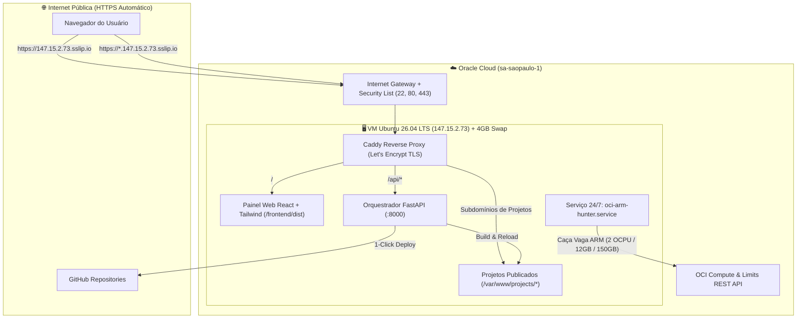

# 🏛️ Arquitetura, Diagnóstico OCI e Guia Prático de Operação da VM

Este documento consolida o diagnóstico de engenharia realizado na sua conta **Oracle Cloud Infrastructure (OCI — Região `sa-saopaulo-1`)**, as correções determinísticas aplicadas via API e o manual completo para publicar pequenos projetos na sua VM Linux sem precisar dominar linhas de comando.

---

## 🔍 1. Diagnóstico Realizado e Problemas Resolvidos

### 1.1 Por que a VM x86 (`147.15.2.73`) não conectava antes (`Connection timed out`)?
Ao inspecionar sua conta via API REST da Oracle Cloud (`execution/oci_diagnostic.py`), identificamos **3 causas raízes**:
1. **VCN sem Internet Gateway e Route Table vazia:** Existiam múltiplas VCNs com o mesmo nome (`vcn-20261009-1708`). A VCN onde a `vm-wdk-amd-x86` estava realmente conectada (`ocid1.vcn.oc1.sa-saopaulo-1.amaaaaaaju7cfdyawoslif6bhtmm2ktznpx5apgtgpgzaag7xeyzh34qlk6a`) estava com `internetGateways: []` e `routeRules: []`.
2. **Erro de `sourcePortRange` na Security List:** As regras de entrada (Ingress) das portas `80` e `443` estavam exigindo que a porta de origem (`sourcePortRange`) também fosse `80` e `443` — o que bloqueia navegadores reais (que usam portas altas dinâmicas na origem).
3. **Firewall interno do Linux (`iptables`):** As imagens oficiais do Ubuntu na Oracle Cloud vêm com uma regra `REJECT` na cadeia `INPUT` que bloqueia as portas `80` e `443` internamente no sistema operacional até que sejam abertas no `iptables`.

**Solução Aplicada (`execution/oci_fix_network.py` + `execution/provision_vm_x86.sh`):**
- Criado o Internet Gateway `igw-vm-wdk-active` e vinculada a rota `0.0.0.0/0` na Route Table da sub-rede ativa.
- Corrigida a Security List com `sourcePortRange: null` para as portas TCP `22`, `80` e `443` + ICMP.
- Liberadas as portas `80` e `443` no `iptables` interno do Ubuntu 26.04 LTS.

---

### 1.2 Por que a criação da VM ARM (`4 OCPU / 24 GB RAM / 200 GB`) falhava na sua conta?
Ao consultar diretamente a **API de Limites da Oracle Cloud (`limits.sa-saopaulo-1.oci.oraclecloud.com`)** da sua conta, descobrimos os limites máximos (*Service Limits*) reais atribuídos à sua Tenancy em São Paulo:

| Recurso na OCI (`sa-saopaulo-1`) | Parâmetro da API | Teto Real da sua Conta | Em Uso pela VM x86 | Disponível para a VM ARM |
| :--- | :--- | :---: | :---: | :---: |
| **OCPUs Ampere A1 (ARM)** | `standard-a1-core-count` | **2 OCPUs** | 0 | **2 OCPUs** |
| **Memória RAM Ampere A1** | `standard-a1-memory-count` | **12 GB** | 0 | **12 GB** |
| **Armazenamento Always Free** | `total-free-storage-gb` | **200 GB** | 50 GB | **150 GB** |

> [!IMPORTANT]
> Quando você tentava pedir **4 OCPU, 24 GB RAM e 200 GB** no painel, a Oracle recusava imediatamente com `HTTP 400 (LimitExceeded)` porque o teto da sua conta em São Paulo para Ampere A1 é de **2 OCPU e 12 GB de RAM**, e já há **50 GB** de disco usados pela VM x86 (restando **150 GB** gratuitos).
> Nosso robô `execution/oci_arm_hunter.py` agora lê esses limites automaticamente da API e solicita **`2 OCPU / 12 GB RAM / 150 GB SSD`**, passando por todas as validações de cota e disputando diretamente a vaga física nos servidores de São Paulo 24 horas por dia!

---

## 🏗️ 2. Diagrama da Arquitetura Implementada



---

## 🚀 3. Como Usar no Dia a Dia (Sem Precisar de Comandos Linux)

### 3.1 Acessar o Painel Orquestrador da sua VM (Protegido por Google Login)
Abra no seu navegador:
- **Painel Principal (HTTPS Zero-Trust):** https://147.15.2.73.sslip.io *(Exige login Google exclusivo com `williamdevide@gmail.com`)*
- **Projeto Vitrine de Exemplo (Público):** https://demo.147.15.2.73.sslip.io

### 3.2 Publicar um Novo Projeto (1-Clique)
1. No painel **https://147.15.2.73.sslip.io**, vá no card **"Publicar Projeto na VM (1-Clique)"**.
2. Selecione um dos seus repositórios no menu dropdown (carregados automaticamente da sua conta do GitHub) ou cole a URL de qualquer repositório GitHub.
3. Escolha o nome do subdomínio (ex: `meu-portfolio`).
4. Clique em **"Publicar Projeto Agora"**.
5. Em segundos, seu projeto estará online com cadeado HTTPS seguro em:
   `https://meu-portfolio.147.15.2.73.sslip.io`!

### 3.3 Comandos Úteis (Caso queira acessar via SSH pelo VS Code / Terminal)
A chave privada já foi configurada com permissões seguras no seu Windows em `C:\Users\William\.ssh\oracle_vm_x86.key`:
```powershell
# Entrar no terminal Linux da sua VM:
ssh -i "$env:USERPROFILE\.ssh\oracle_vm_x86.key" ubuntu@147.15.2.73
```

---

## ⚡ 4. Guia do A.C.O. v3.0 (Coolify Edition)

### 4.1 Telemetria de Disco e Memória por Projeto + Plataforma A.C.O. Core
- Na barra lateral esquerda, acesse **"Telemetria & Plataforma A.C.O."** ou observe os cards de cada projeto em **"Projetos & Aplicações"**.
- O A.C.O. v3.0 mede em tempo real:
  - **Memória RAM (`MemoryCurrent` via cgroups do `systemd`)** e **Espaço em Disco** da própria **Plataforma A.C.O. Core** (`antigravity-dashboard.service`, `oci-arm-hunter.service`, `caddy.service` e `/opt/antigravity-oracle`).
  - **Memória RAM** e **Espaço em Disco** individuais de cada projeto publicado (`/var/www/projects/<slug>`) e de cada banco de dados provisionado (`/var/lib/aco-databases`).

### 4.2 Auto-Deploy GitHub Contínuo + Botão de Deploy Manual
- **Detecção Automática Híbrida:**
  1. **Git Commit Watcher (60s):** Uma rotina assíncrona no FastAPI (`autodeploy_watcher_loop`) consulta a cada 60 segundos o hash do último commit no GitHub (`git ls-remote`) de todos os projetos com `Auto-Deploy` ativo. Se detectar um novo `git push`, faz o `git pull`, recompila e publica automaticamente.
  2. **Webhook Instantâneo GitHub:** Caso você tenha `GITHUB_TOKEN` configurado ou adicione o Webhook (`https://147.15.2.73.sslip.io/api/webhooks/github/<slug>`), o deploy inicia no exato segundo do `git push`.
- **Deploy Manual Sob Demanda:**
  - Nos cards de projeto ou dentro da visão detalhada do projeto, clique em **"Deploy Manual"** / **"Deploy Manual Agora"** para forçar uma nova sincronização e compilação imediatamente, ou clique em **"Verificar GitHub Agora"** no topo do painel.

### 4.3 Gestão Completa do Projeto (Estilo Coolify)
Ao clicar em **"Gerenciar"** em qualquer projeto, você acessa 4 abas dedicadas:
1. **Configurações, Domínio & Auto-Deploy:** Controle o ciclo de vida (`Iniciar`, `Parar`, `Reiniciar`), ative/desative o `Auto-Deploy`, personalize o comando de inicialização, copie a URL do Webhook e altere o subdomínio HTTPS (`https://<novo-nome>.147.15.2.73.sslip.io`) sem precisar refazer o deploy.
2. **Variáveis de Ambiente (`.env`):** Edite variáveis `CHAVE=VALOR` (injetadas automaticamente em `/frontend/.env`, `/backend/.env` e no `systemd`) ou injete a `DATABASE_URL` de qualquer banco de dados em 1 clique.
3. **Histórico & Logs de Deploy (`deploymentsHistory`):** Veja todos os deploys realizados no projeto (commit hash, mensagem, gatilho `manual` / `auto-watcher` / `webhook-github`, duração em segundos e console completo do build).
4. **Logs em Tempo Real (`systemd journalctl`):** Acompanhe a saída ao vivo (`stdout`/`stderr`) do servidor backend da aplicação.

### 4.4 Bancos de Dados 1-Clique (`SQLite`, `PostgreSQL`, `MySQL/MariaDB`, `Redis`)
- Na aba **"Bancos de Dados 1-Clique"**, escolha o nome do banco e o motor desejado:
  - **SQLite 3 Isolado:** Zero consumo extra de RAM, ideal para protótipos e APIs leves.
  - **PostgreSQL 16 Tuned / MariaDB Tuned / Redis Cache:** Instalados e ajustados automaticamente para baixo consumo de memória na VM.
- Após criar, basta selecionar o projeto desejado no seletor **"Conectar este banco a um projeto"** e clicar em **"Injetar no .env"**.


